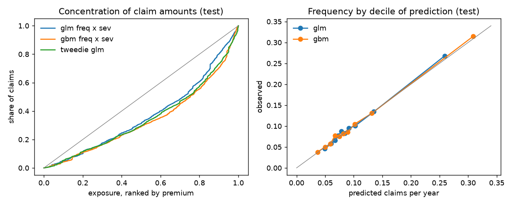

# Motor liability pricing on open data: GLM against gradient boosting, large claims and a 1-in-200 check (v0.1)

[](https://github.com/michaelserikov/motor-pricing-glm/actions/workflows/tests.yml)

How much better does gradient boosting price motor third-party liability than a tariff GLM, what do the large claims do to the premium, and how much capital does the retained portfolio need at the 1-in-200 level? The project fits the pricing chain of a non-life insurer to the open French motor liability data (freMTPL2: 678,013 policies, 26,444 claim amounts): Poisson frequency with exposure, gamma severity of claims capped at a large-claim threshold, a generalised Pareto tail for the claims above it, a Tweedie GLM on the pure premium for comparison, and a Monte Carlo of the annual aggregate under per-claim excess-of-loss retentions against the Solvency II standard formula.

**Main findings** (test set: 20% of the policies, 135,603 policies, models fitted on the other 80%)
- Gradient boosting ranks risks better than the tariff GLM: frequency Gini 0.34 against 0.28, explained Poisson deviance 8.5% against 5.0%. Both are well calibrated by decile. In a double lift chart sorted by the ratio of the two predictions, boosting follows the observed frequency at both ends where the GLM flattens (highest decile: observed 2.31 times the portfolio mean, boosting 2.54, GLM 1.28).
- Severity is almost unpredictable from the rating factors: both models explain 0.4% of the gamma deviance of the capped mean claim. Pricing differences come from frequency; the claim size enters mainly through the large-claim load.
- The tail is extremely heavy: the GPD shape is 0.88 to 1.07 depending on the threshold, at or beyond the point where the mean of the excess is infinite. Three claims above 1 million EUR (the largest 4.1 million) carry 6% of all claim amounts. The large-claim load therefore uses the observed mean excess per claim; the GPD mean would be four times higher at the 95% threshold and is infinite at 97.5%.
- Without a per-claim excess-of-loss cover the 1-in-200 aggregate has no stable value (6 to 8 times the expected claims in three simulations). With a retention of 250,000 EUR, process risk alone needs capital of 17% of the expected claims at the 1-in-200 level, 22% with a 5% systematic variation of the claim frequency from year to year and 33% with 10%. The standard formula for this line, 3 x 8% of premium volume (10% gross, times 80% for non-proportional reinsurance), lies in that range: its calibration includes parameter and cycle risk that a single-year Poisson model leaves out.
- One large claim moves the total: the test set has 25% less in claim amounts than the 80% training set predicts for it (9.4 against 12.6 million EUR), because the largest claims fell into the training set.

## Results



**Frequency** (claims per year of exposure, test set; `results/frequency.csv`):

| Model | Poisson deviance | Explained deviance | Gini | Predicted claims (observed 7,284) |
|---|---|---|---|---|
| Portfolio mean | 0.631 | 0% | 0.00 | 7,201 |
| Poisson GLM | 0.599 | 5.0% | 0.28 | 7,178 |
| Gradient boosting, Poisson loss | 0.577 | 8.5% | 0.34 | 7,180 |

**Pure premium** (claim amounts per year of exposure; `results/pure_premium.csv`): Gini of the frequency and severity chain 0.27 for the GLMs and 0.33 for boosting; the Tweedie GLM fitted to the pure premium directly reaches 0.31 with the same rating factors, between the two.

**Large claims** (individual claims of the training policies; `results/large_claims_threshold.csv`):

| Threshold (quantile) | EUR | Claims above | GPD shape | Mean excess, observed | Mean excess, GPD |
|---|---|---|---|---|---|
| 90% | 2,782 | 2,114 | 0.88 | 12,010 | 17,737 |
| 95% (base) | 4,856 | 1,057 | 0.96 | 21,162 | 86,735 |
| 97.5% | 8,245 | 529 | 1.07 | 37,537 | infinite |
| 99% | 16,890 | 212 | 0.94 | 80,551 | 280,695 |

**Premium risk of the test portfolio** (5,273 expected claims with an amount; 20,000 simulated years; `results/premium_risk.csv`). Capital is the 1-in-200 annual retained aggregate minus its mean, as a share of the mean:

| Per-claim retention | No systematic variation | Frequency varies by 5% | Frequency varies by 10% |
|---|---|---|---|
| 100,000 EUR | 12% | 18% | 30% |
| 250,000 EUR | 17% | 22% | 33% |
| 1,000,000 EUR | 33% | 36% | 43% |
| none | about 6 times the mean, unstable | | |

The GPD and the observed claims agree on the retained excess of a large claim up to the retention (13,806 against 14,542 EUR per large claim at 250,000 EUR), so the retained tail is well determined even though the full tail is not.

Tariff relativities of the frequency GLM are in `results/frequency_relativities.csv` (one-hot levels against the first level, numeric factors per standard deviation). Vehicles of age 0 have about three times the frequency of older ones in this data; drivers aged 25 to 30 about two thirds of the frequency of drivers under 21.

## Method

- **Data.** freMTPL2freq and freMTPL2sev from OpenML (IDs 41214 and 41215), originally from the R package CASdatasets. Claim counts are capped at 4 and exposures at one year, as in the case study of Noll, Salzmann and Wüthrich. 9,116 policies have claims in the count but no amount in the severity file (36,056 counted claims against 26,444 amounts); frequency is modelled on the counts, and the pure premium scales it by the share of counted claims with an amount (0.73 in training).
- **Frequency.** Poisson GLM on claims per year with exposure as weight (`newton-cholesky`, a very small ridge penalty): bands for driver age and vehicle age, vehicle power capped at 9, bonus-malus capped at 150 and its logarithm, log population density, area, brand, fuel and region. Gradient boosting (scikit-learn `HistGradientBoostingRegressor`, Poisson loss, native categorical splits, early stopping on 15% of the training data) on the raw factors.
- **Severity.** Gamma GLM and boosting with gamma loss on the mean capped claim per policy, with the number of claims as weight. Claims are capped at the 95% quantile of individual claims (4,856 EUR).
- **Large claims.** Peaks over threshold: GPD by maximum likelihood on the excesses of the training claims, threshold stability at four quantiles. Load per claim: observed mean excess times the share of claims above the threshold.
- **Pure premium.** Frequency x paid share x (capped severity + load), against a Tweedie GLM (power 1.9) on claim amounts per year. Gini from the exposure-weighted concentration curve; calibration and double lift by exposure deciles.
- **Premium risk.** Annual claims count Poisson with the GLM's expected claims (optionally gamma-mixed for a systematic frequency variation), severities resampled from the capped body or drawn from the GPD above the threshold, each claim capped at the retention. Standard formula comparison: premium risk standard deviation 10% for motor vehicle liability (Delegated Regulation (EU) 2015/35, Annex II), adjustment factor 80% for non-proportional reinsurance (Article 117), capital 3 x sigma x volume.

## Limitations

- One country, one portfolio and one year of exposure in the data: no trend, inflation, claims development or reporting delay. Claim amounts are taken as final.
- The test split is random by policy, not by time, so it measures ranking within the same year and not stability over time.
- The capital comparison is indicative: the standard formula applies to premium volume, the simulation to expected claims; reserve risk, catastrophe risk, expenses and reinsurance cost are left out; the systematic variation is an assumption, not estimated.
- No pricing constraints of practice (smoothness of relativities, market and regulatory limits, monotonicity of the boosting model), and no fairness analysis of the rating factors.

## Run

```bash
python -m venv .venv
.venv/Scripts/activate            # Windows; on Linux/macOS: source .venv/bin/activate
pip install -e ".[test]"
python -m motorpricing.run        # downloads freMTPL2 from OpenML on the first run, writes results/ and figures/
pytest                            # offline tests on synthetic data
```

## Data and references

| Source | Content | Licence |
|---|---|---|
| [OpenML 41214](https://www.openml.org/d/41214), [OpenML 41215](https://www.openml.org/d/41215) | freMTPL2freq (policies, exposure, claim counts, rating factors), freMTPL2sev (claim amounts) | CC0 as listed on OpenML; originally from the R package CASdatasets |

- Noll, A., Salzmann, R. and Wüthrich, M. V. (2018): Case Study: French Motor Third-Party Liability Claims. SSRN 3164764. https://doi.org/10.2139/ssrn.3164764
- Commission Delegated Regulation (EU) 2015/35 (Solvency II), Annex II and Article 117. https://eur-lex.europa.eu/eli/reg_del/2015/35/oj
